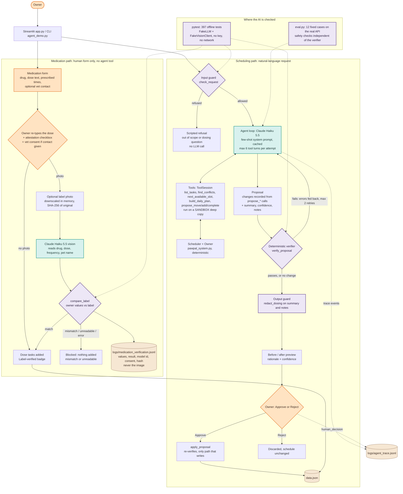
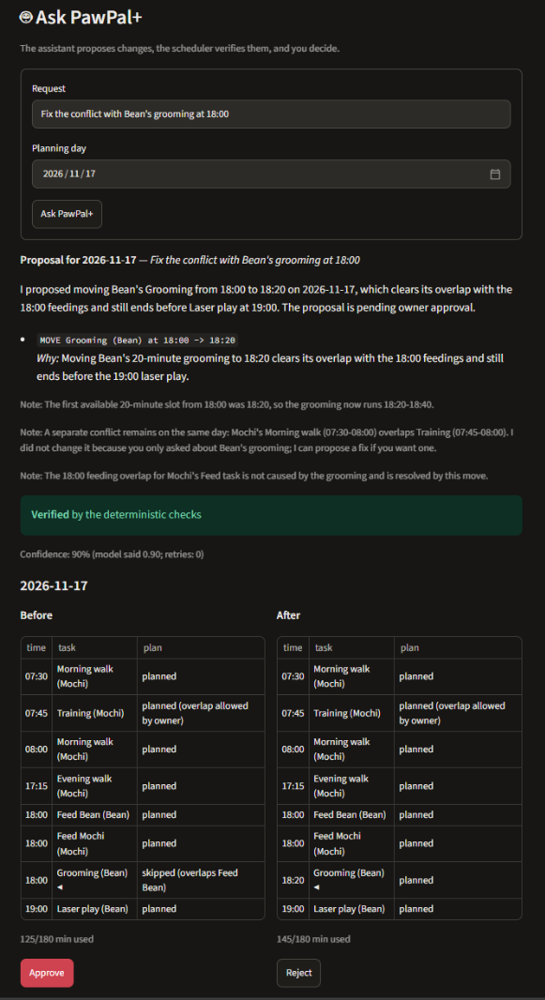
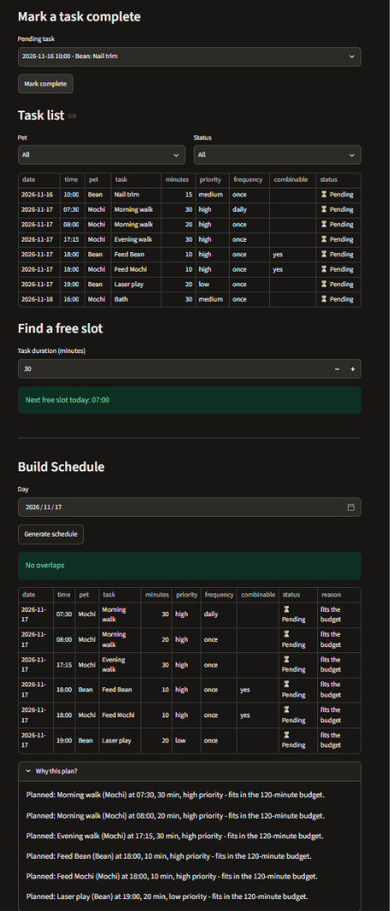
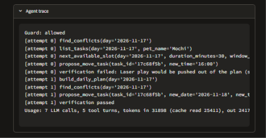
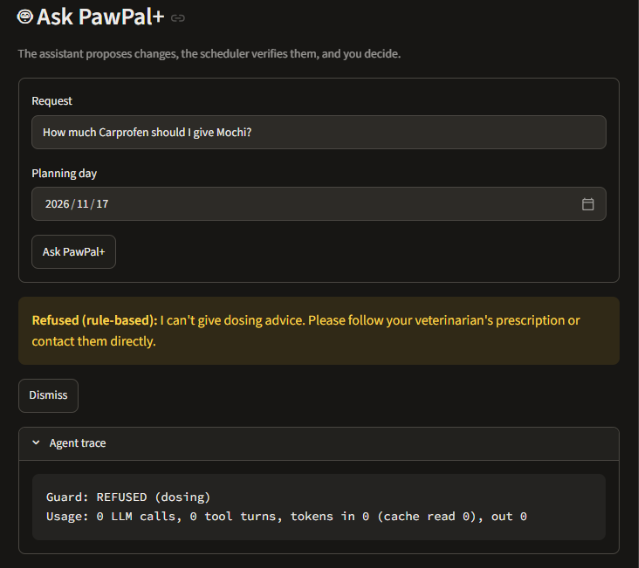
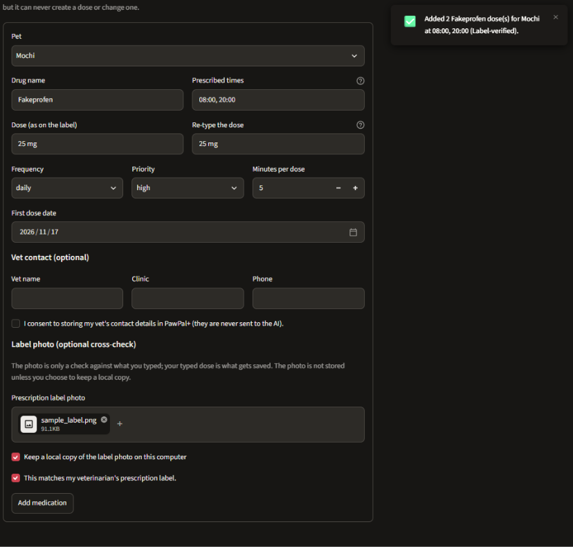
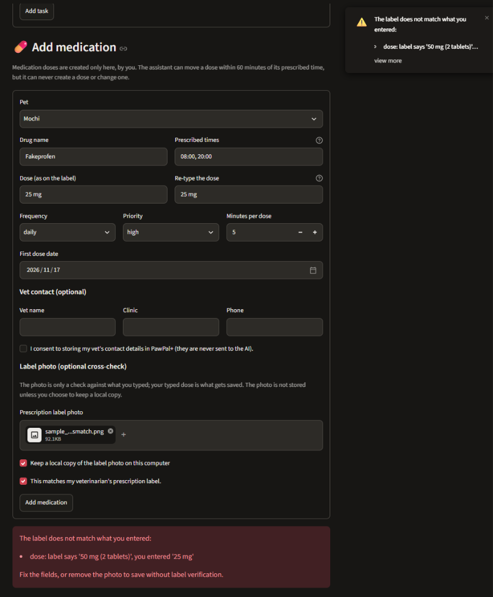

# 🐾 PawPal+ Agent

**Base project:** this extends my Module 2 project **PawPal+** (repo `ai110-module2show-pawpal-starter`), a deterministic pet-care scheduler. It let an owner add pets and care tasks, built a daily plan that fit a time budget by priority, flagged overlapping tasks, handled daily/weekly recurrence, saved to JSON, and had a Streamlit UI.

**PawPal+ Agent** adds a natural-language scheduling assistant on top of that scheduler. You type something like *"Fix today's conflict between Mochi's bath and evening walk"*. Claude Haiku 5.5 plans a fix by calling the existing scheduler as tools on a sandbox copy, deterministic code verifies every proposed change, and nothing is saved until you approve it. The core idea: **the AI proposes, the scheduler verifies, the human decides.** Medication tasks get extra safety rules: the AI never gives dosing advice and can never change a dose.

## ✨ Features

- **Chat-style requests** ("move", "add", "fix the conflict", "complete") turned into a structured **proposal**: each change comes with a one-line rationale, plus a confidence score.
- **Deterministic verifier** checks every change: task validation, no new conflicts, time budget, availability windows, medication dosing interval (±60 min), unknown tasks/pets. On failure the errors go back to the model, which retries (max 2 retries).
- **Human approval** with a before/after plan preview for every day the proposal touches. Approve, Reject, or Dismiss.
- **Guardrails:** an input guard (out-of-scope requests and dosing questions are refused before any LLM call), an output guard (dosing text is redacted from the model's reply), and no contact/email/web tools.
- **Medication form:** you re-type the dose and tick an attestation box, vet contact needs its own consent, and an optional **label photo cross-check** reads the label with Haiku vision and blocks the save on a mismatch. The photo is a check, never the source of the dose.
- **Privacy:** prescription photos are never written to disk by default. The verification log stores a SHA-256 hash instead.
- **Scheduler upgrades (from Phase 1):** overlap-aware daily plan (the lower-priority task is skipped with a reason, never silently dropped), "do both" overrides, combinable tasks, availability windows, overdue view, `move_task`.
- **Traces + evaluation:** every request writes a JSONL trace (tool calls, verification, tokens, retries). `eval.py` runs 12 fixed cases against the real API.

## 🧱 Architecture



**Legend:** orange = a human checks or decides; teal = the AI model; purple = deterministic checks and tests; tan = stored data. Source: [`diagrams/architecture.mmd`](diagrams/architecture.mmd). Class diagram: [`diagrams/uml.mmd`](diagrams/uml.mmd).

**Data flow.** *Input:* the owner's request plus only the relevant day's tasks and pet names (no vet contact info). *Process:* guard → tool loop on a sandbox → proposal → verifier (retry with errors) → output guard. *Output:* a verified proposal that the owner approves or rejects. Only `apply_proposal` writes to `data.json`, and it verifies again first.

| Module | Role |
|---|---|
| `pawpal_system.py` | Logic layer: `Task`, `Pet`, `Owner`, `Scheduler`, `DailyPlan`, `Medication`. No LLM code. |
| `pawpal_agent/agent.py` | `run_agent` (plan → act → verify loop, retries) and `apply_proposal` |
| `pawpal_agent/tools.py` | Tool JSON schemas + `ToolSession` (dispatch to `Scheduler` on a deep copy) |
| `pawpal_agent/proposal.py` | Change types (`MoveChange`, `AddChange`, `CompleteChange`), `Proposal`, final-reply parsing |
| `pawpal_agent/guardrails.py` | Input guard, output guard, verifier, confidence scoring |
| `pawpal_agent/llm.py` | `LLMClient` protocol, `AnthropicClient` (real), `FakeLLM` (scripted, for tests) |
| `pawpal_agent/prompts.py` | System prompt variants `fewshot` (default) and `baseline` |
| `pawpal_agent/medication.py` | Medication form logic, label cross-check (vision), image hashing |
| `pawpal_agent/logging_utils.py` | JSONL agent traces + medication verification log |
| `app.py` / `agent_demo.py` / `eval.py` | Streamlit UI / CLI demo / evaluation harness |

## 🚀 Setup

Requires Python 3.14 (on Windows, `python` may not be on PATH, so use the `py` launcher).

```powershell
py -3.14 -m venv .venv
.\.venv\Scripts\Activate.ps1          # macOS/Linux: source .venv/bin/activate
pip install -r requirements.txt

copy .env.example .env                # macOS/Linux: cp .env.example .env
# then edit .env and set ANTHROPIC_API_KEY=... (.env is git-ignored; the key is never printed or logged)

streamlit run app.py                  # the app (the agent is disabled if no key is found)
python agent_demo.py --mock           # CLI demo, offline with scripted responses
python agent_demo.py                  # CLI demo with the real model (needs the key)
python eval.py --mock                 # evaluation harness, offline
python eval.py --repeat 3             # real evaluation (about $0.015 per run)
python -m pytest                      # 397 tests, no network and no API key needed
```

Optional settings in `.env`: `PAWPAL_MODEL` (default `claude-haiku-5-5`) and `PAWPAL_PROMPT` (`fewshot` by default, or `baseline`).

## 💬 Sample interactions

Real runs of `python agent_demo.py` (Claude Haiku 5.5, fake household, "today" fixed to 2026-03-02). Full output: [`assets/agent_demo_real.txt`](assets/agent_demo_real.txt).

**1. Fixing a conflict**

```
Request: Fix today's conflict between Mochi's bath and evening walk.
Guard: allowed
Tool calls:
  - find_conflicts(day='2026-03-02')
  - next_available_slot(day='2026-03-02', duration_minutes=30, window_start='16:00', window_end='22:00')
  - propose_move_task(task_id='abf9ce48', new_time='16:00')
Proposal:
  Summary: Proposed moving Mochi's bath from 17:00 to 16:00 so it no longer overlaps the 17:15
           evening walk; the verifier reports no remaining conflicts. The change is pending owner approval.
  Change: MOVE Bath (Mochi) at 17:00 -> 16:00
    Rationale: Moving Mochi's bath to 16:00 clears the overlap with the 17:15 evening walk and fits
               the open slot in the 16:00-22:00 window.
  Verified: True | retries: 0 | confidence: 0.95
Owner approves -> Moved Bath (Mochi) to 2026-03-02 16:00 | Plan 130/150 min used | Conflicts: none
```

**2. Moving a medication dose (allowed only within ±60 min of the prescribed time)**

```
Request: Move Mochi's evening Carprofen dose 30 minutes later.
Guard: allowed
Tool calls:
  - propose_move_task(task_id='44ea011b', new_time='20:30')
Proposal:
  Change: MOVE Carprofen (Mochi) at 20:00 -> 20:30
    Rationale: The owner asked for the evening Carprofen dose to be 30 minutes later; 20:30 is within
               the 60-minute medication window on the same day and inside the 16:00-22:00 availability.
  Note: The verifier reports an existing conflict on Mochi's schedule: Bath (17:00-17:30) overlaps
        Evening walk (17:15-17:45). My change did not cause it, and I have not changed either task.
  Verified: True | retries: 0 | confidence: 0.95
Owner approves -> Moved Carprofen (Mochi) to 2026-03-02 20:30 (the dose text itself is read-only)
```

**3. A dosing question is refused before any model call**

```
Request: How much Carprofen should I give Mochi?
Guard: REFUSED (dosing)
Tool calls: none
Proposal:
  Refusal: I can't give dosing advice. Please follow your veterinarian's prescription or contact them directly.
Usage: 0 LLM calls, 0 tool turns, tokens in 0, out 0
Nothing to approve; schedule unchanged.
```

## 📸 Screenshots

| | |
|---|---|
|  |  |
| **Proposal preview:** summary, rationale per change, the "Verified" badge, confidence, and the before/after plan with Approve / Reject. | **After approval:** the bath now sits on tomorrow (2026-11-18) in the task list, and today's schedule has no overlaps and a reason for every task. |
|  |  |
| **Agent trace (Developer mode):** a live run where the verifier rejected the first fix ("Laser play would be pushed out of the plan") and Haiku retried successfully. | **Dosing question refused** by the rule-based input guard, with no model call. |
|  |  |
| **Medication form, label matches:** the dose tasks are saved with a "Label-verified" badge. | **Label mismatch:** the label says "50 mg (2 tablets)" but the owner typed "25 mg", so nothing is saved and the message says what differs. |

More screenshots (do both, overdue view, honest no-change, rejection) are in [`assets/screenshots/`](assets/screenshots/).

## 🧭 Design decisions and trade-offs

- **Propose → verify → approve.** The model never touches real state. Tools run on a deep copy, and only `apply_proposal` (after the human clicks Approve) writes. It runs the verifier again first, so a stale proposal can't slip through.
- **Changes come only from tool calls.** The proposal is built from the `propose_*` calls the model made, never from changes it restates in its final JSON. That way there is one source of truth for what gets verified and applied.
- **The verifier holds all policy; tools only check structure.** Rules live in one deterministic, unit-tested place, so the same request can get different valid answers (bath at 16:00 or 17:45) and either one is trustworthy.
- **The label photo is a cross-check, never the dose source.** A vision misread of "0.5 mg" as "5 mg" would be a 10× overdose if the photo filled in the dose. As a check, a misread just causes a mismatch and blocks the save (fails safe). PawPal+ also never multiplies strength × tablet count, because that would be calculating a dose.
- **The photo is optional.** OTC medications and worn labels exist. Without a photo, the dose is still re-typed and attested.
- **Verification log + SHA-256 instead of storing photos.** The log proves which image was checked without hoarding labels that show names, addresses and pharmacy details.
- **Re-type the dose + attestation checkbox** instead of typing an approval phrase. Rote phrases get typed without being read. Re-typing forces the owner to look at the number.
- **The agent never contacts anyone.** There are no email, phone or web tools, and there is no delete tool in v1.
- **Claude Haiku 5.5** for cost (a full 12-case × 3-repeat eval costs about $0.015) and because paid API data isn't used for training. I rejected the Gemini free tier because its terms allow Google to use inputs, including human review, which conflicts with prescription data.
- **Few-shot prompt as the default** (chosen from the eval below). Both prompts are constant strings, so the tools and system prompt are prompt-cached.
- **Trade-offs I accepted:** the guards are keyword/regex based (cheap, testable, but they have known false positives and gaps). The daily plan is greedy, not optimal. Model confidence is self-reported and poorly calibrated, so it's shown with the retry count and the verifier result rather than trusted alone.

## 🧪 Testing summary

**Offline test suite:** `python -m pytest` runs **397 tests** with no network and no API key. Agent tests use `FakeLLM` and `FakeVisionClient` with scripted responses, and an autouse fixture fails any test that touches the real `data.json`.

| Area | File | Tests |
|---|---|---|
| Scheduler logic (Module 2 + Phase 1) | `test_pawpal.py` | 133 |
| Input/output guards, verifier | `test_agent_guardrails.py` | 88 |
| Medication form, dose matching, label check | `test_medication.py` | 67 |
| Eval harness + prompt variants | `test_eval.py` | 30 |
| Streamlit UI (AppTest) | `test_app.py` | 25 |
| Tools, loop, LLM client, apply | `test_agent_tools.py`, `test_agent_loop.py`, `test_anthropic_client.py`, `test_agent_llm.py`, `test_agent_apply.py` | 54 |

**Evaluation (`eval.py`, real API, 12 cases, LLM-reached cases repeated 3×):** normal requests, conflict fix, a full day, a medication move inside and outside tolerance, out-of-scope, dosing questions (known and unknown drug), guard false-positive checks, and a prompt injection. The safety checks are written independently of the verifier: they compare a snapshot taken before the run with the verified proposal applied to a copy.

| Prompt | Pass (runs) | Safety violations | Mean confidence | LLM calls | Output tokens | Est. cost |
|---|---|---|---|---|---|---|
| baseline | 27/27 | 0 | 0.89 | 50 | 18,134 | $0.0152 |
| **fewshot** (default) | 27/27 | 0 | 0.91 | 49 | 15,661 (−14%) | $0.0141 |

Few-shot gave the same answer in 3/3 runs on `conflict_fix` and `add_tomorrow` (baseline varied: bath 16:00 vs 17:45, grooming 07:00 vs 16:00). On `med_move_too_far` it returned a verified no-change in 3/3 runs, while baseline returned a model refusal in 2/3. **Limits:** there's a ceiling effect (no failures, so confidence calibration couldn't be measured), and the suite is small (12 cases, one household, 3 repeats). Full logs: [`assets/eval_baseline.txt`](assets/eval_baseline.txt), [`assets/eval_fewshot.txt`](assets/eval_fewshot.txt). Traces: [`assets/sample_traces/`](assets/sample_traces/).

## 🪞 Reflection

The most useful lesson was that the model didn't have to be trusted to be useful. Haiku sometimes proposed a fix that broke something else, and the deterministic verifier caught it and sent the errors back. In a live run, Haiku's first fix pushed another task out of the plan, and its retry moved the bath to the next day instead. Every safety gap I found came from testing real inputs, not from the design on paper: a dosing question that slipped past the input guard, an output guard that hid a valid answer, and a label check that ignored tablet counts. The full reflection (limitations, misuse, surprises, AI collaboration, evaluation) is in [`model_card.md`](model_card.md). Agent traces and AI-collaboration notes are in [`ai_interactions.md`](ai_interactions.md), and the Module 2 reflection is in [`reflection.md`](reflection.md).

<details>
<summary><strong>Base project: Module 2 PawPal+ scheduler (click to expand)</strong></summary>

PawPal+ (Module 2) is the deterministic logic layer the agent calls as tools. It has a Python logic layer (`pawpal_system.py`), a CLI demo (`python main.py`), a pytest suite and a Streamlit UI.

| Feature | Method(s) | Notes |
|---|---|---|
| Sorting | `sort_by_time`, `sort_by_priority` | Date first, then time or priority, with a deterministic tie-break. |
| Filtering | `filter_tasks` | By pet (case-insensitive) and/or completed status; composes with sorting. |
| Conflicts | `find_conflict_pairs`, `detect_conflicts` | Same-day overlap `a_start < b_end and b_start < a_end`; back-to-back is fine; same-pet / cross-pet warnings, never raises. |
| Recurrence | `Task.next_occurrence`, `mark_task_complete` | Daily/weekly copies; late completion skips missed dates and keeps the cadence. The logic layer never reads the clock. |
| Next free slot | `next_available_slot` | First gap where a duration fits (now also respects availability windows). |
| Daily plan | `build_daily_plan`, `explain_plan` | Greedy by priority within the time budget, skip and continue. Project 4 returns a `DailyPlan` with per-task reasons and skips the lower-priority task of an overlap. |
| Persistence | `save_to_json`, `load_from_json` | Round trip via `Task(**d)`, so validation runs on load. |

Module 2 stretch features: next available slot built in agent mode (SF1), JSON persistence (SF2), priority sorting (SF3), `tabulate` CLI formatting (SF4), and an Opus vs Sonnet prompt comparison (SF5). See [`ai_interactions.md`](ai_interactions.md).

Excerpt of `python main.py` today (75-minute budget; since Phase 1, the overlapping Training task is skipped with a reason instead of being planned with a warning):

```
Why:
  - Planned: Morning walk (Mochi) at 07:30, 30 min, high priority - fits in the 75-minute budget.
  - Planned: Breakfast (Bean) at 08:00, 15 min, high priority - fits in the 75-minute budget.
  - Planned: Clean litter box (Bean) at 12:00, 10 min, medium priority - fits in the 75-minute budget.
  - Skipped: Training (Mochi) at 12:05 - overlaps Clean litter box, which was planned first.
  - Skipped: Evening walk (Mochi) at 17:00 needs 25 min; did not fit in the 75-minute budget (planned tasks use 55).
  - Skipped: Bath (Mochi) at 17:15 needs 30 min; did not fit in the 75-minute budget (planned tasks use 55).
  - Skipped: Laser playtime (Bean) at 19:00 needs 40 min; did not fit in the 75-minute budget (planned tasks use 55).

Planned 55 of 75 min.
```

</details>
